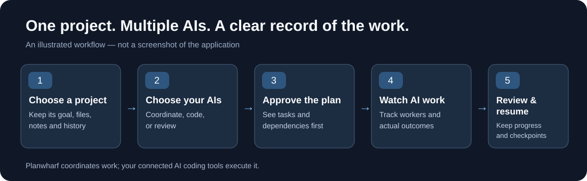

# Planwharf

Workers run in the linked project folder. Implementation and audit launches require an existing directory; a missing or unlinked folder blocks launch, and the chat says so. Planwharf resolves the folder and rejects a launch working directory outside it. This is a launch and inspection boundary, not an operating-system sandbox for arbitrary provider commands.

Git evidence is unavailable for inherited parent repositories, external Git worktrees, shared object stores, or redirected/symlinked Git metadata. Linking a real project directory still permits worker launch; unavailable Git evidence is reported conservatively.

Git status and diff inspection exclude submodules so their worktrees and redirected metadata cannot pull another project's state into this project's evidence.

**Where projects dock, agents work, and progress stays anchored.**

A local project notebook and coordinator for AI coding workers across models and providers. Chat with a lead model, choose a team that builds and verifies, approve the work or let the crew run it, and follow every step in the conversation.

Planwharf includes native Codex, Grok, Antigravity and Claude Code CLI adapters, direct OpenAI-compatible and Anthropic Messages API connections, and a configurable CLI adapter for compatible structured protocols. Add an API connection from **Team → Connect a model by API**. DeepSeek, Kimi and other providers can use compatible APIs without pretending to be another provider. See [connection setup and limitations](docs/EXTERNAL-PROVIDERS.md). Exact model access, tool support and credentials remain account-specific; installing an arbitrary CLI does not guarantee protocol compatibility. Live access to every provider/model has not been verified. Please [report missing integrations](https://github.com/benitz94/Planwharf/issues) with the OS, CLI/protocol version, exact model ID and sanitized error.

Planwharf is still under active development and is provided **as is**. Features and behavior may change, and bugs or limitations may remain. Feedback, development suggestions, and contributions are welcome. Please share bug reports and ideas through GitHub Issues.

[Quick start](docs/QUICKSTART.md) | [First project guide](docs/HOW-TO.md) | [The chat view](docs/CHAT-VIEW.md) | [User guide](docs/USER-GUIDE.md) | [FAQ](docs/FAQ.md) | [Project status](docs/PROJECT-STATUS.md) | [Continue work](docs/CONTINUE-WORK.md) · [Phase 2 execution contract](docs/PLANWHARF-PHASE-2.md)

## Planwharf at a glance



**Create a project → choose your team → let the crew work (or approve each step) → follow it in the chat → check the result.**

The diagram is a conceptual overview, not a screenshot of the application. For practical details, see the [FAQ](docs/FAQ.md).

## Why Planwharf?

AI coding CLIs can implement tasks, but running several of them separately leaves you to track decisions, assignments, progress and interrupted work yourself. Planwharf adds a **persistent project notebook and a coordinated execution workflow** around the AI tools you already use.

- **Keep the project, not just the conversation:** goals, decisions, notes and revisions remain connected to project history.
- **Coordinate supported AI connections:** approve a MegaTask, see its SubTasks, and control which exact provider/model can coordinate, implement or review.
- **Know what actually happened:** inspect worker attempts, reported tests, changed files, blockers and execution evidence instead of assuming that a process exit means success.
- **Resume deliberately:** Stop and Pause preserve partial work and checkpoints; Resume checks project state and avoids automatically repeating finished SubTasks.
- **Work locally:** the notebook and backend run on your computer; AI provider connectivity and credentials remain subject to the chosen integration.

Planwharf does not promise perfect model compatibility or complete worker sandboxing. Windows has the strongest end-to-end verification so far. For a concise introduction, see the [FAQ](docs/FAQ.md).

## Download the latest release

For normal installation, open the [latest GitHub Release](https://github.com/benitz94/Planwharf/releases/latest) and download the release asset named `Planwharf-vX.Y.Z.zip` under **Assets**. The same release ZIP is used on Windows, macOS and Linux.

- **Windows:** extract the ZIP and launch `Planwharf.exe` (or `planwharf.cmd` / `node planwharf.cjs`).
- **macOS / Linux:** extract the same ZIP and run `sh ./planwharf.sh` or `node ./planwharf.cjs`.
- `planwharf-update.json.gz` is update metadata, not the application download.
- GitHub's automatically generated **Source code (zip/tar.gz)** archives are repository snapshots; prefer the packaged `Planwharf-vX.Y.Z.zip` release asset for normal installation.

Node.js and any provider CLIs are installed separately.

On Linux, one command installs it for your user: `curl -fsSL https://raw.githubusercontent.com/benitz94/Planwharf/main/install.sh | sh`. A desktop app with its own window is being prepared. See [Desktop app and Linux install](docs/DESKTOP.md).

## Start here

Planwharf opens on a chat with your lead model. **You are the captain**: you set the goal and the team, the crew builds and verifies, and you can stop it at any time.

1. Download `Planwharf-vX.Y.Z.zip` from the [latest GitHub Release](https://github.com/benitz94/Planwharf/releases/latest), extract the complete application folder, install Node.js, and on Windows open `Planwharf.exe`.
2. Sign in to at least one supported coding CLI, or connect an API with authorized exact model IDs. Chat subscriptions do not automatically grant API or CLI access.
3. In **Team**, choose the lead, give one model **Build** and another, preferably from a different provider, **Verify**.
4. Press **+ New project**, give it a name and a new folder. Then tell the lead what to build in plain words and press **Use as the goal**.
5. Press **Let the crew do it** to turn on [project autonomy](docs/PROJECT-AUTONOMY.md), or describe the work in the chat and press **Approve and start** on the lead's proposal. Follow the **Crew at work** card, then test the output in the project folder. Completion does not commit, push or publish it.

The [first project guide](docs/HOW-TO.md) walks through each step; [the chat view](docs/CHAT-VIEW.md) explains the screen. The remaining README sections provide reference details.

## Understand your project and AI work

The chat is the only screen. Projects are on the left; **Team**, **Progress**, **Usage**, **Files** and **Settings** open one at a time beside the chat. Proposals, the crew's live progress, results and warnings appear as cards in the conversation. Short commands such as `show usage` or `bench <model>` run locally without a model call. Details: [the chat view](docs/CHAT-VIEW.md).

Model recognition and provider integration are extensible. The currently implemented local coding CLI adapters are Codex, Grok, Antigravity and Claude Code. They discover exact model IDs from the active CLI login's catalog, including Gemini, Claude and GPT-OSS families supported by Antigravity. Additional model IDs can be configured when the selected CLI supports them; a different provider's CLI requires its own adapter implementation. See [Providers and execution](#providers-and-execution).

No provider is preferred behind the scenes. In **Team**, each model has independent roles: **Lead** (Orchestrator), **Build** (Worker), **Verify** (Verifier), and optional **Review** (Reviewer) and **Watch** (Supervisor). A model with no role sits on the bench. Roles are assignment restrictions: a Verify-only model never builds, and a lead-only model is never dispatched as a worker. **AI tools** switches each provider on or off. An unavailable model is reported explicitly and never silently replaced.

**Usage** shows the quota **left** in each provider's shared pool; every model on that pool sees the same value. When a provider does not report quota, its reason is shown instead of a number. Calls, durations and output tokens are listed per model; a value the provider does not report shows "not reported", never zero or an estimate.

Approve proposed work before workers run it, or turn on autonomy for the project. **Stop work** terminates current workers and saves a checkpoint. **Resume** continues from it, keeps finished steps, and asks for confirmation when the repository or plan changed.

**Settings → Move a project** saves a project as readable JSON (metadata, revisions, notes, tasks, results, checkpoints, history and a Markdown summary; never source, raw logs or credentials) and opens such a file as a new project. See [Continue work](docs/CONTINUE-WORK.md).

Closing the window or **Settings → Quit** saves checkpoints and shuts Planwharf down. After updating application files by hand, quit and relaunch to load the new code.

## Requirements and launch

Install Node.js and a modern browser such as Firefox, Brave, Opera, Edge or Chrome. Planwharf has no npm dependencies. Install and authenticate the coding CLIs you want to use separately.

**CLI authentication and model access are required for AI work.** Complete sign-in or credential setup in each supported CLI before using it in Planwharf. Signing in to a provider's chat website or app does not authenticate its CLI. Your account must also include access to the requested model through that CLI: a plan that includes only chat access is insufficient. Listing or configuring a model in Planwharf does not grant access, credits or quota. Planwharf uses the CLI's existing authentication; it does not turn a chat subscription into CLI access.

For a first Windows launch after downloading from GitHub:

1. Download the latest GitHub Release ZIP, or clone the repository / use **Code → Download ZIP**, and extract the entire archive. Each push to `main` publishes the next patch release (`v0.1.1`, `v0.1.2`, …).
2. Install Node.js separately if it is missing; the download does not include or install Node.js.
3. Keep the application files together and double-click `Planwharf.exe` in the extracted folder. No `npm install` step is required.
4. To run coding workers, separately install and sign in to the provider CLIs you want to use. They are not required just to open the notebook.

The executable checks for Node.js before starting the application. If it cannot find it, it shows: **“Node.js was not found. Install Node.js, then double-click Planwharf.exe again.”** The dialog also includes a startup log path. If `planwharf.cjs` is missing, download and extract the complete application folder again.

On Windows, double-click `Planwharf.exe` or `planwharf.cmd`, or run:

```powershell
node .\planwharf.cjs
```

To rebuild the Windows launcher, run `launch\build-exe.cmd`; it requires the .NET Framework compiler.

### Windows, macOS and Linux

| OS | Launch from the application folder | Verification status |
| --- | --- | --- |
| Windows | Double-click `Planwharf.exe` or `planwharf.cmd`, or run `node .\planwharf.cjs` in PowerShell. | Verified platform; includes the Windows executable launcher. |
| macOS | Run `node ./planwharf.cjs` or `sh ./planwharf.sh` in Terminal. | Launch paths are implemented; end-to-end operation has not been verified on macOS. |
| Linux | Run `node ./planwharf.cjs` or `sh ./planwharf.sh` in a terminal. | Launch paths are implemented; end-to-end operation has not been verified on Linux. |

On macOS and Linux, install Node.js, extract or clone the complete application folder, then launch from that folder:

```sh
cd /path/to/Planwharf
sh ./planwharf.sh
```

No `npm install` step is required. The shell launcher forwards command-line options, including `--plan`, `--attempts-dir` and `--port`. The Windows `.exe` and `.cmd` launchers are specific to Windows.

On every OS, install and authenticate each coding CLI in the same user environment that starts Planwharf. On macOS/Linux, CLI discovery looks for `codex`, `grok` and `agy` on `PATH`; for a custom location, set `PLANWHARF_CODEX`, `PLANWHARF_GROK` or `PLANWHARF_ANTIGRAVITY` to the executable's absolute path before launch. Each CLI must support the requested model and Planwharf's execution options on that OS; model recognition alone does not establish OS compatibility.

Planwharf opens in an automatically detected browser in application mode, or the system default. Choose another with `Planwharf.exe --browser firefox`, `node planwharf.cjs --browser default`, `--browser "absolute executable path"`, or `PLANWHARF_BROWSER`. A choice saved earlier in `<notebook>.browser.json` still applies; use `--browser default` if that browser is no longer installed. macOS and Linux browser launch paths are implemented but have not been verified end to end.

`Planwharf.exe` is a launcher: keep it with the complete application folder, including `planwharf.cjs`, `engine`, and `fixtures`, and install Node.js on each computer. Startup diagnostics are saved per launch under `%LOCALAPPDATA%\Planwharf\logs`; an error dialog includes the log path. `PLANWHARF_LAUNCH_LOG_DIR` can select another log directory. Browser launch failures attempt to open the same notebook in the default browser.

Closing and immediately reopening the application clears stale window state. If native focus fails, the launcher requests a new window instead of silently accepting an old heartbeat. Interrupted startup locks recover automatically while preserving malformed lock bytes. A live, unresponsive notebook owner is retained and reported within approximately ten seconds. See [startup verification](docs/STARTUP-VERIFICATION-2026-10-13.md) for the isolated launcher and browser checks.

The server binds to `127.0.0.1`, normally on port 4173, and chooses another port when necessary. Desktop launch opens one window on the chat; older addresses such as `/#orchestrator` or `/orchestrator.html` open the same page. Relaunching the same notebook reuses its backend and focuses or reopens the window. Closing the window or **Settings → Quit**, or Ctrl+C in the terminal, saves checkpoints and shuts down. Window heartbeats expire after 15 seconds if close events are unavailable.

## Start a project

Press **+ New project** and enter a name and a folder. Then say what to build in the chat and press **Use as the goal** under your message. Leave the folder empty to create a new subfolder named after the project inside the default projects folder (**Settings → New projects**); existing names receive a numbered suffix. Enter an existing folder to work on existing code.

**Settings → This project** changes a project's folder. The default projects folder persists in `<notebook>.settings.json`; changing it affects future projects and does not move existing folders. **Settings → Remove project** removes the notebook entry while keeping its folder.

Use a separate notebook for experiments:

```powershell
node .\planwharf.cjs --plan .\my-notebook.json --attempts-dir .\my-attempts --port 4180
```

Explicit notebook paths must already contain valid Planwharf data. The default `plan.json` is local data, excluded from Git. On first launch only, the application creates it from `fixtures/starter-notebook.json` if it does not exist. Existing notebooks are never replaced. Preserve the notebook and its attempts directory when updating the application.

## Notebook, revisions, and Grill

- Each project keeps a Living Plan: goal, current state, decisions and open questions. Revisions are appended, never overwritten; a task keeps the revision it came from.
- **Ask me questions first** starts Grill: the lead asks one question at a time, each with its suggested answer, and records the decisions.
- Personal notes, **Grill with the docs**, and the revision editor were part of the earlier screens and are not in the chat view. Data they saved is kept.

A Grill answer can leave a question open, close it with a decision, or close it and change direction. Existing decisions are preserved. A revision object has this shape:

```json
{
  "title": "First month ready",
  "direction": "Open the library two mornings each week.",
  "state": "Two volunteers confirmed.",
  "closed": ["Loans are free."],
  "open": ["Which extra day should we add?"]
}
```

Malformed JSON, unknown fields, and invalid types are rejected without changing the notebook. Supported revision modes are `manual`, `grill`, and `import`. A task keeps its originating `revision_id` even after later edits. Each project can have at most one running task.

## Local files and private GitHub repositories

**Files** lists the paths changed since the last Git commit in the project folder, with the branch name. The repository check behind it also compares the local branch with the linked GitHub repository using the existing `gh` login, including private repositories accessible to that account; that remote comparison is not shown in the chat view.

The comparison fetches the linked repository's current branch history into dedicated inspection refs. It does not merge, push, switch branches, or overwrite working files. When the local branch is unpublished, the comparison explicitly uses GitHub's default branch as its baseline. Diverged histories and failures remain visible; old tracking refs are not reported as a current GitHub check.

The lead receives a compact briefing for the selected project, its active work, recent results, checkpoint, AI-relevant notes and repository delta. Older conversation exchanges stay in the local archive; only six bounded recent turns are sent. Registered project paths support explicit recipient selection; the lead must inspect only the selected project unless the current request names another. By default its CLI retains the existing full filesystem/network permissions without interactive approvals; the per-provider Always approve / YOLO policy can restrict future launches. Its prompt keeps it in a coordination role: workers implement jobs. A role instruction is not a filesystem sandbox.

The account must already have repository access. A URL alone cannot grant it. Check `gh auth status` or use `gh auth login` if authentication is missing. Credentials are not embedded in notebooks or model prompts.

## Providers and execution

`models.json` uses schema 3 with a `providers` array; each provider declares its adapter, quota pool, and model entries. Model entries retain explicit provider and CLI model IDs. The runner launches that adapter and exact model; it rejects incompatible combinations and never silently routes GPT or Gemini labels to Grok. The configuration examples below describe individual entries inside a provider's `models` array.

Model recognition is extensible through configuration. The installed adapters are `codex`, `antigravity`, `grok`, `claude`, `api`, and `configured-cli`; a model family name alone does not select an adapter. The `claude` adapter uses Claude Code and its current CLI login; see [Claude Code setup](docs/EXTERNAL-PROVIDERS.md#claude-code-subscription-cli). Native model families retain their compatibility guard. For a different exact model ID that your selected CLI has explicitly been configured to accept, add `"modelRouting": "configured"`. This removes the family-name restriction while retaining the exact provider and CLI ID. It does not install a provider, verify account access, or change a CLI's supported models. Unknown adapters remain unavailable with a clear error.

For example, this is a disabled template for a Qwen route through a separately configured compatible Antigravity CLI. Replace the placeholder with the exact ID accepted by your CLI; use the same pattern for Kimi or any future model. Claude IDs already match Antigravity's native family guard, but still require actual account access. Leave unverified entries disabled and unavailable until you have checked the selected CLI and account:

```json
{
  "id": "my-qwen",
  "label": "Qwen (configured route)",
  "provider": "antigravity",
  "cli": "EXACT_MODEL_ID_FROM_YOUR_CLI",
  "modelRouting": "configured",
  "enabled": false,
  "available": false,
  "unavailableReason": "This exact provider/model route has not been verified.",
  "plan": "My configured account",
  "kind": "default",
  "cost": 1,
  "limit": 50
}
```

Labels are for display; they never select a provider. Configuration errors disable the roster entry and show the reason. A compatible declaration permits dispatch only after you enable the entry and mark it available; the CLI may still reject model access at runtime, and Planwharf reports that failure without substituting another model.

On the verified account, GPT-6 Astra, GPT-6 Luna, GPT-6 Sol, GPT-6.1 Sol, GPT-5.6 Luna, and GPT-5.5 completed inference checks. Gemini Pro and Flash were used through Antigravity. GPT-5 and GPT-5 mini were explicitly rejected by Codex with this ChatGPT account and remain **Unavailable**. Grok 4.6 is switched off after a credit/spending-limit HTTP 403. These checks describe one account and date, rather than universal model availability.

Choose a lead in **Team**. When you describe new work, the lead proposes a persistent MegaTask and its dependent steps; a card shows them, and **Approve and start** launches exactly that MegaTask. Approval binds to it; turning on [project autonomy](docs/PROJECT-AUTONOMY.md) lets the crew approve its own steps within limits. Worker tool permissions do not require repeated interactive confirmation.

Models with a role are candidates, not a requirement to use every model for every task. A build job runs as two steps: a **Build** model implements it with tests, then a **Verify** model, preferably from another provider, checks it and fixes what fails. When a step has more than one allowed model, the lead picks; with one allowed model per step, your roles decide. With no verifier the job is one step and Planwharf only runs the tests.

The **Crew at work** card shows each step's model and state and, in plain words, what the running model is doing. **Progress** lists steps and recent activity. Each chat request carries the selected project's explicit ID; a message naming a different project cannot execute a command for it. Chat never chooses a project based on which one is busiest.

Project actions use the buttons in the chat (**Approve and start**, **Stop work**, **Resume**, **Let the crew do it**) or explicit chat commands such as **Start**, **Stop**, **Approve**, **Resume** or **Skip grill**. A new work request creates a fresh task with the exact current prompt and waits for approval. Previous inactive tasks are retained as superseded; their checkpoints are archived unchanged. An active job must be stopped before replacing it. Questions do not create tasks, and a new request never implicitly resumes a previous checkpoint.

Models receive only the task and Planwharf's own instructions: there are no skill catalogs.

After updating Planwharf code by hand, quit Planwharf and relaunch it to load the new backend.

**Look for models again** (in Team) queries supported provider catalogs for the active CLI login, replacing old account availability without substituting models or automatically assigning roles. A fresh check runs at backend startup before model selection and dispatch. Models absent from a successfully read catalog disappear from model cards and selectors, while saved roles, pinned selections and historical execution evidence retain their exact IDs. Newly discovered IDs start with no assigned roles. The last successful catalog is saved locally per provider configuration and recognized account; a failed login, network or malformed-catalog check retains it and reports verification as unread. An explicitly empty catalog removes every model from that provider. Unchanged-login status polling does not invoke provider CLIs. Detected account changes trigger a new catalog check and invalidate cached quota. Confirmed organizational accounts add **Business** to their labels; normal accounts keep their names. Role flags are saved separately for recognized accounts. Authentication and policy failures are shown as verification failures, not as invented account access.

A failed model-list check preserves previously known availability and shows a warning; it does not fabricate access to other IDs. An unreadable Grok quota endpoint is separate from access to the Grok CLI and does not itself disable models.

Chat requests accept up to 1 MiB of JSON. Provider prompts avoid the Windows command-line length limit: Codex uses standard input, Antigravity uses its documented JSON user-event stream on standard input, and Grok reads a unique UTF-8 prompt file through its native `--prompt-file` option. Prompt files are kept outside linked project folders. Saved exchanges are retained without a fixed turn limit. Each lead answer receives the full retained history once in chronological order, together with the current notebook briefing. The provider's context limit still applies; automatic history compaction is not implemented.

You can ask the lead to delegate a research task conversationally, naming a worker such as GPT-6 Luna. The lead proposes a structured research assignment; the notebook validates the exact model and its usage, then returns a persistent MegaTask proposal to approve before any worker starts. Research uses a separate attempt folder, preserves existing implementation tasks, and writes findings and citations to `report.md` in that folder. A completed report requires both the report artifact and successful provider exit evidence.

Source-protected research currently uses Codex with its workspace write sandbox and network access. Linked project files are available for reading; only the isolated research workspace is writable. Other providers are rejected for this workflow until equivalent source protection is supported. Resume creates a new attempt while keeping prior research evidence. A lead's proposed assignment is not evidence that a worker has started; the notebook's dispatch receipt is authoritative.

## Stop, Resume, and quotas

Stop terminates worker process trees and saves a checkpoint. Phase 2 also preserves remaining work after worker failures, pause, and shutdown/restart. For a task that already has a **Finish by** deadline, at the first scheduling check at or after it, it blocks new slices, terminates active worker process trees, and saves a deadline checkpoint with completed results and partial evidence retained. Valid completion of every slice takes precedence over interruption. Termination failures remain visible and are retried; they do not falsely mark live workers as stopped. Checkpoints have no expiry and survive restarts; **Resume** appears in the chat. Resume verifies the job identity and creates fresh attempts for remaining work. Explicit Resume after a deadline continues beyond the original expired time. It does not restore the interrupted model's internal memory. See [deadline verification](docs/DEADLINE-VERIFICATION-2026-10-13.md).

Existing tasks never start automatically after backend startup, even when automatic approval was saved; they require fresh authorization. Workers already running continue to be monitored.

Running activity translates structured Codex, Grok and Antigravity events into readable actions such as "Reading Sayaku.ts" or "Running tests for Sayaku.test.ts". It follows the latest action and distinguishes a completed command from proof that tests passed. Raw logs remain unchanged in the attempts folder.

Planwharf's own checks (no model call) watch for blocked or failed work, repeated unsuccessful results, a stopped process without a result, completion conflicting with live work, and ten minutes without progress. Each appears as a **Something needs a look** card that you can ignore. See [Supervisor](docs/SUPERVISOR.md).

Keep the notebook, settings, attempts directory, and project files together in backups. Forced termination or power loss cannot guarantee saving the last unsaved operation. The running backend monitors active work on a periodic timer, including with the window closed; the interface also polls for updates.

When all worker slices report completion, Planwharf closes the assignment and marks the notebook task `complete`. Later polls and restarts retain that terminal state. Historical process IDs remain recorded, with inactive worker flags; completed tasks cannot resume from an older checkpoint.

To inspect older inconsistent state without dispatching workers, run:

```powershell
node validation/reconcile-attempts.cjs --plan plan.json --attempts-dir .attempts-plan
```

After quitting the application, add `--apply` to repair verified completions. The tool requires matching job identity and `STATUS: COMPLETE` plus `EXIT: 0` for every recorded slice. It backs up the notebook, registry, and orchestrator state before writing, archives state for removed projects, and preserves raw logs, results, and checkpoints. Browser profiles under `windows/` and validation artifacts stay local and are excluded from Git.

Provider quota readings are separate from synthetic model assignment counters. ChatGPT uses local Codex usage windows; Grok uses local billing; Antigravity reads numeric Gemini buckets through `agy -p /usage --output-format json`. All quota UI reports **REMAINING**, shared by every model on the same provider plan. Bands are green at 75?100%, orange at 50?74%, yellow at 25?49%, and red at 0?24%; 0% also says **EXHAUSTED**. Missing or invalid readings show grey **REMAINING UNREAD**, rather than an invented percentage.

## Validation and historical evidence

```powershell
node .\engine\prompt-transport.test.cjs
node .\engine\provider-transport.test.cjs
node .\engine\chat-request.test.cjs
node .\engine\conversation-history.test.cjs
node .\engine\research-dispatch.test.cjs
node .\engine\runtime-integration.test.cjs
node .\engine\worker-startup.test.cjs
node .\verify-app.cjs
node .\verify-chat.cjs
node .\validation\verify-work.cjs
```

Tests cover notebook persistence, revisions, Grill, task references, filesystem settings, provider routing, checkpoints, shutdown/restart, Git comparison graphs, and errors. Test notebooks and attempts are isolated from personal projects. `verify-chat.cjs` drives the chat view in a real headless browser (set `PLANWHARF_TEST_BROWSER` to a Chromium or Edge executable): first run, team roles, folder, chat, local commands, a fake crew from proposal to result, project export/import, provider switches, API connection, layout at three widths and the dark theme. Browser checks under `validation/` belong to the earlier screens and are kept as historical evidence.

A previous real orchestrator run produced a Windows calculator through Gemini workers and passed 15 GUI checks plus five engine self-tests. Its project was subsequently removed at the owner's request. Preserved local execution evidence documents that historical run; it is not a currently installed calculator.

Historical `handoff` payloads and execution logs preserve their original language as evidence. Current product documentation is in English. Personal notebook content and test fixture text are user/sample data, rather than translated product documentation.

Phase 1 validation: `node validation/phase1-suite.cjs` runs every engine test, root verification script, browser folder/worker checks, and real app-window checks. Each run writes a new evidence directory and verifies that the personal notebook is unchanged. The isolated browser tests use mocked quotas and no model dispatch. Chromium sandbox restrictions in the validation environment require `--no-sandbox` for tests only; normal launch retains browser defaults.

## Usage policies and repository integrations

See [usage and integration policies](docs/USAGE-AND-INTEGRATION-POLICIES.md) for model usage thresholds, popup notices, explicit fallback routes, per-provider Always approve / YOLO controls, Gitea authentication, periodic commit checks, and provider error reports. Repository checks update information and inspection refs only; project source is preserved.

## License

Planwharf is free software licensed under the **GNU General Public License version 3 only (GPL-3.0-only)**. See [LICENSE](LICENSE) and [COPYRIGHT](COPYRIGHT).

You may use, study, modify, and redistribute Planwharf, including for commercial use, paid distribution, and paid support, when you comply with GPL-3.0-only. No automatic royalty is required for compliant commercial distribution. Private modifications that are not conveyed do not by themselves require source publication.

A separate license from the maintainer is required only to distribute Planwharf or a covered derivative without complying with the applicable GPL obligations, for example under incompatible proprietary terms. Possible commercial terms can be negotiated later; no such agreement or royalty rate is established here.

External contributions require the applicable [Individual CLA](CLA.md) or [Entity CLA](CLA-ENTITY.md); contributors retain copyright, and the public project remains GPL. See [CONTRIBUTING.md](CONTRIBUTING.md) and [licensing details](docs/LICENSING-PROPOSAL.md). The GPL does not grant rights to present a fork as the official Planwharf project or as endorsed by its maintainer. Third-party notices and licenses remain applicable.

## Updates

Planwharf checks the latest stable GitHub release at desktop startup without downloading or installing it. When one is available, a link appears at the bottom left; **Settings → Updates → Update and restart** installs it after a second press. Every unfinished task is checkpointed first; a failed checkpoint or worker stop cancels the update. After restart, press **Resume** to continue saved work.

For in-app updates, download and extract the **Planwharf-vX.Y.Z.zip** portable asset from a release that includes this feature. Older releases and GitHub source ZIPs need that first manual download. Git checkouts show the release link and never replace local source files automatically. Portable installations verify the official package checksum, refuse to overwrite locally modified application files, preserve notebooks/settings/credentials/execution evidence, and keep backups under `.planwharf-updates`. Installation errors restore previous application files and are reported on restart. Node.js remains a separate prerequisite.

**Grill me** in the Orchestrator dashboard starts a short interview directly in the selected project's chat, including projects without a local folder. Replies remain clarification until an explicit Start; the resulting task retains the discussion and still needs approval before workers run. Select an available orchestrator first. Stop grill ends that chat interview without changing global preferences. Antigravity availability is refreshed through `agy models`; configured model IDs remain unverified until the active CLI lists them, and rejected model IDs are never replaced silently.
