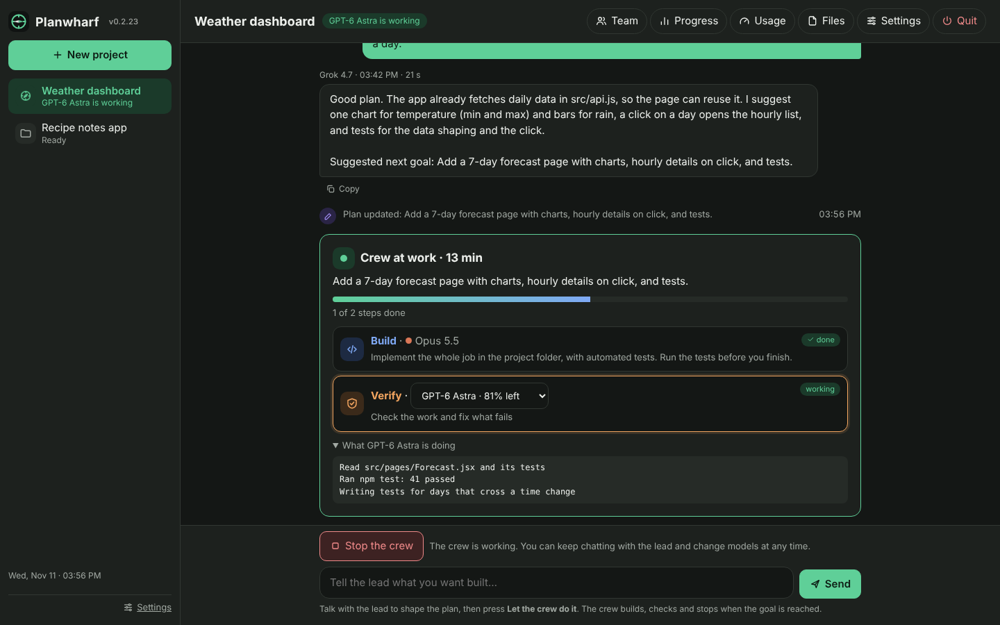
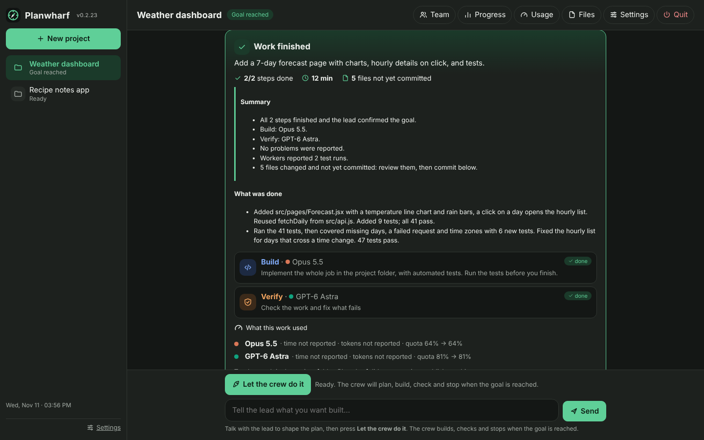
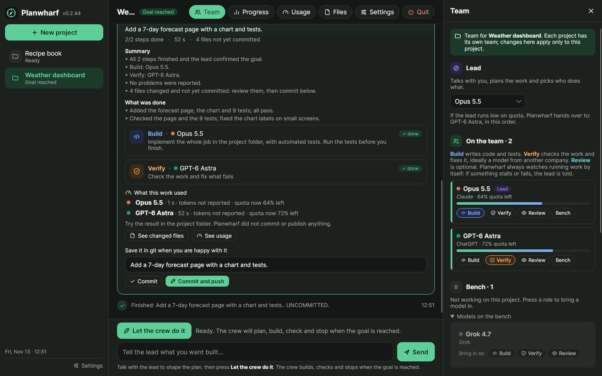
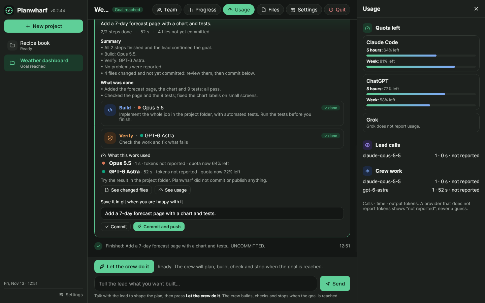
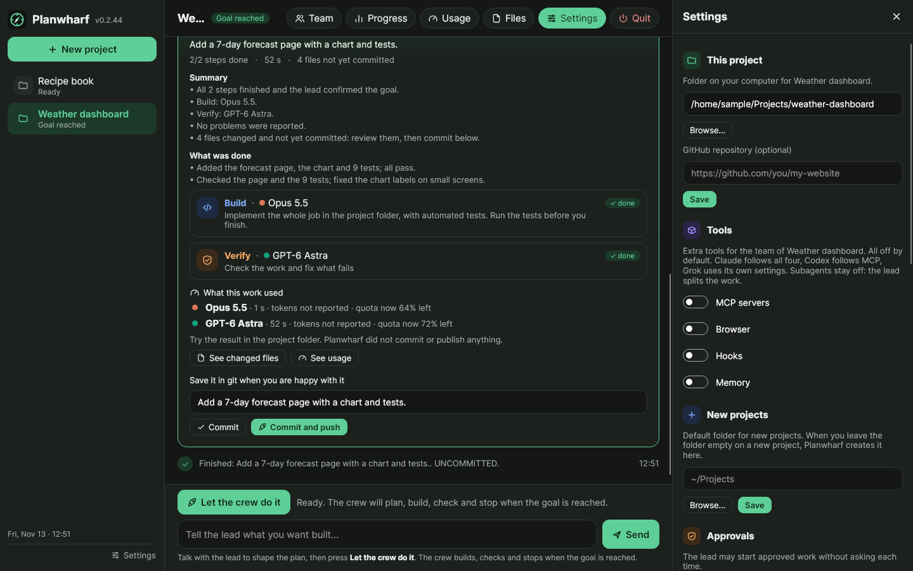

<p align="center"></p>

# Planwharf

**Your team of AI models, in one chat.**

Planwharf is a free app for Linux, macOS and Windows. You tell a lead model what you want built, in plain words. A crew of AI models builds it, a second model checks the work and fixes what fails, and you follow everything in the chat. You can stop it at any time.

- **You are the captain.** You set the goal and choose the team.
- **One model builds, another checks.** The checker can come from another company, so mistakes are less likely to slip through.
- **No Planwharf account, no Planwharf server.** Your project files stay in your folder on your computer.
- **Your AI providers do see your work.** The tools Planwharf runs (Claude Code, Codex, Grok CLI, Antigravity) or the API you connect send your instructions and the code they read to their provider (Anthropic, OpenAI, xAI, Google), under your own agreement with that provider.
- **No passwords.** Planwharf uses the sign-ins you already have. For an API it stores only the name of the environment variable that holds the key, never the key.
- **Your crew decides the cost.** Planwharf does not save tokens or time by itself: what a goal costs depends on the models you choose and on the task.
- **Nothing is published without you.** The work stays in your project folder: Planwharf never commits or pushes by itself. When you are happy with the result, you can commit it, and push it to GitHub, from the Work finished card.

## See it

You talk with the lead in a chat; when the plan is right you press **Let the crew do it**, and the crew builds and checks the work while you watch.



When the work is done, a summary says what happened, who did what and what is left; you can commit and push from there.



| Your team | Quota left | Settings |
|---|---|---|
|  |  |  |

<sub>Screenshots of the native app, on a sample project with sample data.</sub>

## Download

**Use the native app.** It is the version that is developed from now on. The desktop app (Electron) and the web app are **being retired**: they stay in every release for now, as a fallback, and get only fixes for serious errors, no new features. They will be removed, together with the JavaScript engine, once the native app runs on its own C# engine.

| Kind | Windows | Linux | macOS | Needs Node.js | Status |
|---|---|---|---|---|---|
| **Native app** (recommended) | ✅ `Planwharf-native-win-x64-vX.Y.Z.zip` | ✅ `…-linux-x64-…zip` | ✅ Apple silicon and Intel | No: it includes Node.js today (its engine still runs on it) | Developed |
| **Desktop app** (Electron) | ✅ `Planwharf-Setup-X.Y.Z.exe` | ✅ `.AppImage` or `.deb` | not yet | No, included | Being retired |
| **Web app** (portable ZIP) | ✅ | ✅ | ✅ | Yes, 18 or newer | Being retired |

With any kind you also need at least one AI coding tool, installed and signed in: [Claude Code](https://github.com/anthropics/claude-code), [Codex](https://github.com/openai/codex), Grok CLI or Antigravity. A chat subscription alone does not include the command-line tool.

### Native app

A native window instead of a web page, much lighter than the desktop app, with everything the desktop app does: chat with the lead, the crew at work, Team, Progress, Usage, Files, Settings, commit and push. Download the zip for your system from the [latest release](https://github.com/benitz94/Planwharf/releases/latest), extract it and open `Planwharf` (`Planwharf.exe` on Windows).

- **What is native and what is not, yet:** the window is native (no browser inside). Today Planwharf's engine still runs on Node.js, included in the zip (about 75 MB in all), and the window starts it for you. The engine is being ported to C# ([the plan](native/porting/PLAN.md)); when that is done the app will no longer contain Node.js, and it will be the only kind of Planwharf.
- To update, download the new zip: the app tells you when one is out.
- It is not code-signed yet: on Windows choose **More info > Run anyway**; on macOS, if it is blocked, open **System Settings > Privacy & Security** and choose **Open Anyway**.
- It uses the same projects as the desktop app: close one before you open the other.

More in [native/README.md](native/README.md).

### Desktop app (Electron), being retired

Its own window, with Node.js included. No new features: only fixes for serious errors, until it is removed. Download it from the [latest release](https://github.com/benitz94/Planwharf/releases/latest), under **Assets**:

- **Windows 10 / 11 (64-bit):** run `Planwharf-Setup-X.Y.Z.exe`. The installer is not code-signed yet, so Windows SmartScreen may say it "protected your PC": choose **More info > Run anyway** only if you downloaded it from this page.
- **Linux (64-bit):** make `Planwharf-X.Y.Z.AppImage` executable and open it, or on Debian/Ubuntu run `sudo apt install ./planwharf-desktop_X.Y.Z_amd64.deb`.

To update, install the new version over the old one: your projects are kept. More in [docs/DESKTOP.md](docs/DESKTOP.md).


### Web app (portable ZIP), being retired

No new features: only fixes for serious errors, until it is removed.

Opens in your browser's app window and updates itself from **Settings > Updates**. Needs [Node.js](https://nodejs.org/) 18 or newer.

**Linux:** one command installs it for your user, without `sudo`:

```sh
curl -fsSL https://raw.githubusercontent.com/benitz94/Planwharf/main/install.sh | sh
```

Then start it with `planwharf`. To read the script before running it:

```sh
curl -fsSL https://raw.githubusercontent.com/benitz94/Planwharf/main/install.sh -o install.sh
less install.sh
sh install.sh
```

**macOS:** download **`Planwharf-vX.Y.Z.zip`** from the [latest release](https://github.com/benitz94/Planwharf/releases/latest), extract it, open Terminal and run:

```sh
cd ~/Downloads/Planwharf
sh planwharf.sh
```

**Windows:** download **`Planwharf-vX.Y.Z.zip`** from the [latest release](https://github.com/benitz94/Planwharf/releases/latest) (under **Assets**), extract the whole folder and double-click **`Planwharf.exe`**.

Something not working on your system? Please [tell us](https://github.com/benitz94/Planwharf/issues): so far Windows has been tested the most.

## First steps

1. **Team:** choose the lead, give one model **Build** and another **Verify**.
2. **+ New project:** give it a name and a folder.
3. In the chat, tell the lead what you want built, then press **Use as the goal**.
4. Press **Let the crew do it** and follow the work in the chat.

Updates arrive inside the app: **Settings > Updates**. Your projects and settings are kept.

## Learn more

- [User guide](docs/USER-GUIDE.md) · [The chat screen](docs/CHAT-VIEW.md) · [FAQ](docs/FAQ.md)
- [Benchmark: a small SQL database, four AI tools and Planwharf](docs/benchmarks/2026-11-minidb/README.md)
- [Benchmark: Planwharf and four AI tools on the same task](docs/benchmarks/2026-11-logbook/README.md)
- [Technical reference](docs/REFERENCE.md), for advanced users and contributors
- Past verification reports, reviews and handoff notes: the [`archive/old-material-2026-11`](https://github.com/benitz94/Planwharf/tree/archive/old-material-2026-11) branch

Planwharf is under active development and is provided **as is**, without warranty. Ideas and bug reports are welcome in [Issues](https://github.com/benitz94/Planwharf/issues).

## License

Free software under the **GNU General Public License version 3 only** ([LICENSE](LICENSE), [COPYRIGHT](COPYRIGHT)). Contributions need a [CLA](CLA.md); see [CONTRIBUTING.md](CONTRIBUTING.md).
