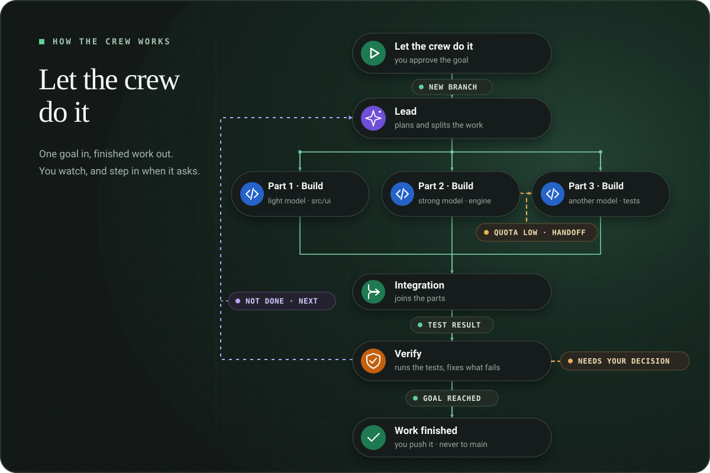
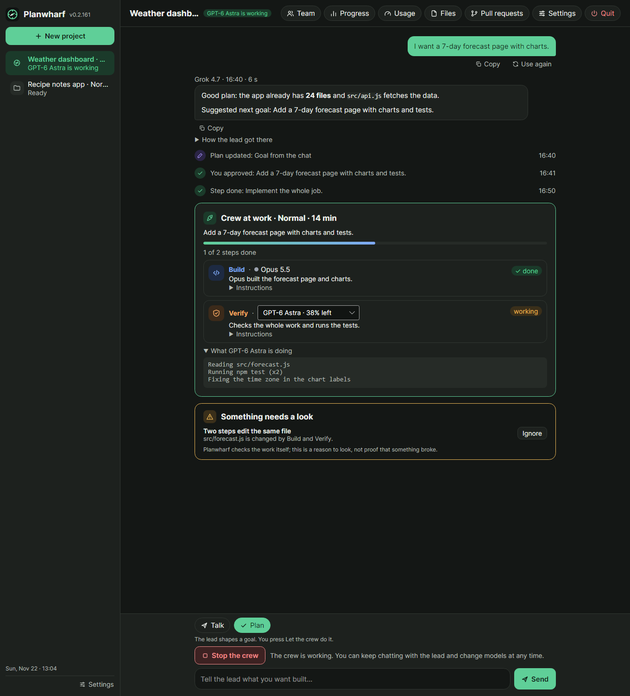
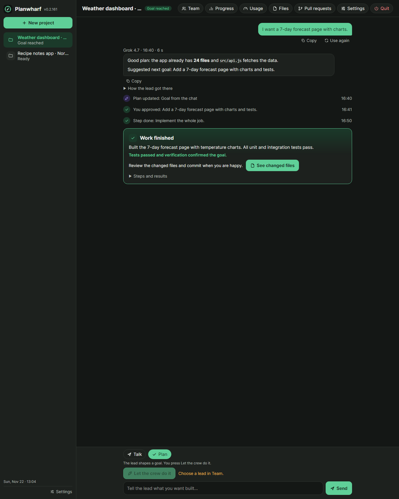
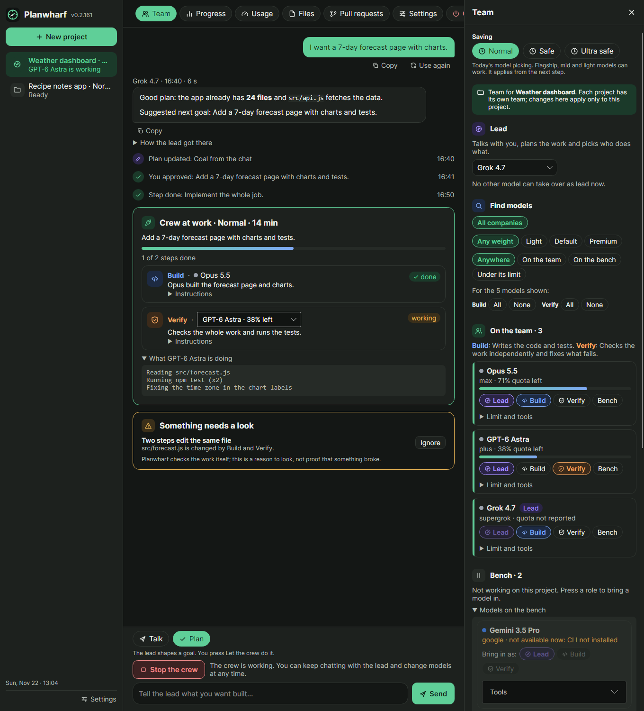
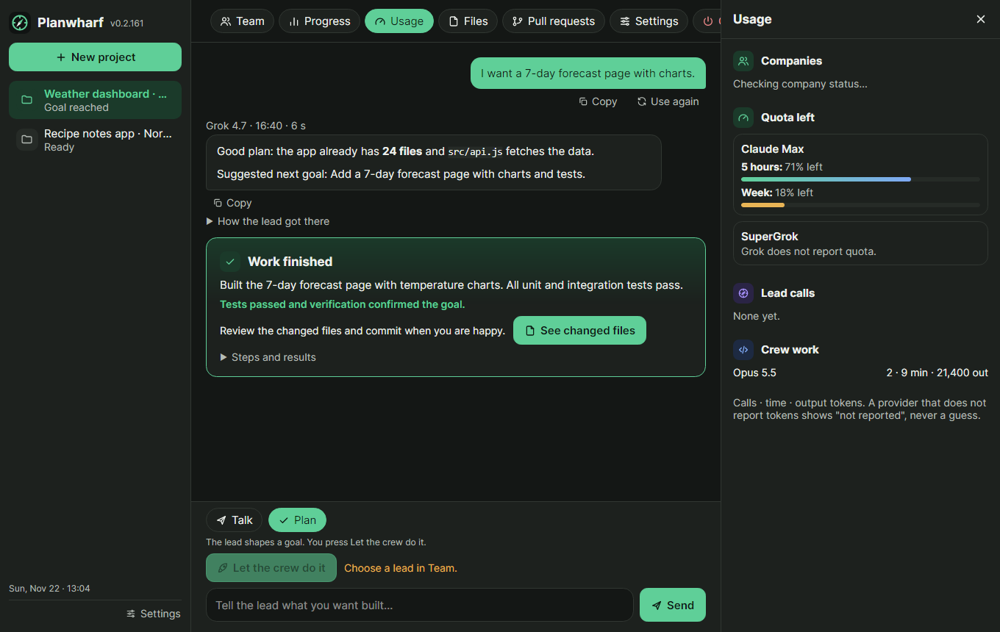
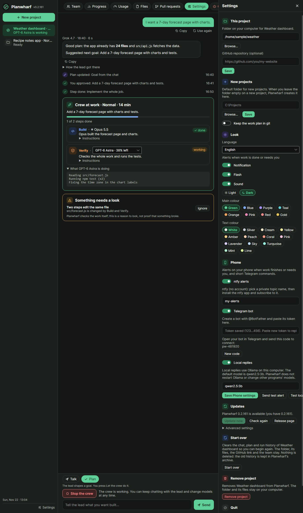

# Planwharf

**Your team of AI models, in one chat.**

<p align="center"></p>

Planwharf is a free app for Linux, macOS and Windows. You tell a lead model what you want built, in plain words. A crew of AI models builds it, a second model checks the work and fixes what fails, and you follow everything in the chat. You can stop it at any time.

- **You are the captain.** You set the goal and choose the team.
- **One model builds, another checks.** The checker can come from another company, so mistakes are less likely to slip through.
- **No Planwharf account, no Planwharf server.** Your project files stay in your folder on your computer.
- **Your AI providers do see your work.** The tools Planwharf runs (Claude Code, Codex, Grok CLI, Antigravity) or the API you connect send your instructions and the code they read to their provider (Anthropic, OpenAI, xAI, Google), under your own agreement with that provider.
- **No passwords.** Planwharf uses the sign-ins you already have. For an API it stores only the name of the environment variable that holds the key, never the key.
- **Your crew decides the cost.** Planwharf does not save tokens or time by itself: what a goal costs depends on the models you choose and on the task.
- **Nothing is published without you.** The crew works on its own branch in your project folder and never pushes; only you publish the result, with one button, and never to `main`. See [Commits and pushes](#commits-and-pushes).

## The models you paid for

You probably have more than one. A strong one for the hard parts, a fast one for the small ones, maybe a local one that costs nothing. In most setups the choice gets made for you. The orchestrator picks, a small model gets used somewhere you never see, and the one you actually wanted stays idle. You subscribed to all of them. You should be the one spending them.

In Planwharf every model you have is on the table. You see it, you see how much quota it has left, and you decide. This one builds. That one checks. This one sits out today. A small, cheap model is not hidden inside the machinery. It is a tool, the same as the strongest one you own, and you point it where it is useful. If you cancel a subscription or add one, the list changes with it. Nothing is reserved, and nothing is spent without you saying so.

## Planwharf builds Planwharf

Planwharf is rewriting its own engine, from JavaScript to C#, **with its own crew**. The owner writes one
line to the lead, *"Read docs/NEXT-WORK.md and continue."*; the lead picks the next job of the plan, one
model builds it, another model checks it and fixes what fails, and every pull request is
reviewed before it is merged.

| So far | |
|---|---|
| Jobs done by Planwharf on itself | **25**, from the first C# modules to the rest of phase 2 of the port |
| C# engine | **23 of 55 modules** ported, 547 tests, 247 cases compared with the JavaScript result by result |
| Improvements found by using Planwharf on itself, and fixed | **31** |
| Companies in the crew so far | Anthropic, OpenAI, Google and xAI |

The full record, job by job, with each crew and what the review changed: [Built with Planwharf](docs/BUILT-WITH-PLANWHARF.md).

## See it

You talk with the lead in a chat; when the plan is right you press **Let the crew do it**, and the crew builds and checks the work while you watch.



When the work is done, a summary says what happened, who did what and what is left; you can commit and push from there.



| Your team | Quota left | Settings |
|---|---|---|
|  |  |  |

<sub>Screenshots of the native app, on a sample project with sample data.</sub>

## Download

**Use the native app.** It is the version that is developed from now on. The desktop app (Electron) and the web app are **deprecated**: they stay in every release for now, as a fallback, and get only fixes for serious errors, no new features. They will be removed, together with the JavaScript engine, once the native app runs on its own C# engine.

| Kind | Windows | Linux | macOS | Needs Node.js | Status |
|---|---|---|---|---|---|
| **Native app** (recommended) | ✅ `Planwharf-native-win-x64-vX.Y.Z.zip`, or `…-win-arm64-…` on ARM | ✅ `…-linux-x64-…zip`, or `…-linux-arm64-…` on ARM | ✅ Apple silicon and Intel | No: it includes Node.js today (its engine still runs on it) | **In development** |
| **Desktop app** (Electron) | ✅ `Planwharf-Setup-X.Y.Z.exe` | ✅ `.AppImage` or `.deb` | not yet | No, included | Deprecated |
| **Web app** (portable ZIP) | ✅ | ✅ | ✅ | Yes, 18 or newer | Deprecated |

With any kind you also need at least one AI coding tool, installed and signed in: [Claude Code](https://github.com/anthropics/claude-code), [Codex](https://github.com/openai/codex), Grok CLI or Antigravity. A chat subscription alone does not include the command-line tool.

### Native app

A native window instead of a web page, much lighter than the desktop app, with everything the desktop app does: chat with the lead, the crew at work, Team, Progress, Usage, Files, Settings, commit and push. Download the zip for your system from the [latest release](https://github.com/benitz94/Planwharf/releases/latest), extract it and open `Planwharf` (`Planwharf.exe` on Windows).

- **What is native and what is not, yet:** the window is native (no browser inside). Today Planwharf's engine still runs on Node.js, included in the zip (about 75 MB in all), and the window starts it for you. The engine is being ported to C# ([the plan](native/porting/PLAN.md)); when that is done the app will no longer contain Node.js, and it will be the only kind of Planwharf.
- To update, press **Settings → Updates → Update now**: the app downloads the new zip, checks it and restarts itself (a copy without that button: download the new zip once).
- It is not code-signed yet: on Windows choose **More info > Run anyway**; on macOS, if it is blocked, open **System Settings > Privacy & Security** and choose **Open Anyway**.
- It uses the same projects as the desktop app: close one before you open the other.

More in [native/README.md](native/README.md).

### Desktop app (Electron), deprecated

Its own window, with Node.js included. No new features: only fixes for serious errors, until it is removed. Download it from the [latest release](https://github.com/benitz94/Planwharf/releases/latest), under **Assets**:

- **Windows 10 / 11 (64-bit):** run `Planwharf-Setup-X.Y.Z.exe`. The installer is not code-signed yet, so Windows SmartScreen may say it "protected your PC": choose **More info > Run anyway** only if you downloaded it from this page.
- **Linux (64-bit):** make `Planwharf-X.Y.Z.AppImage` executable and open it, or on Debian/Ubuntu run `sudo apt install ./planwharf-desktop_X.Y.Z_amd64.deb`.

To update, install the new version over the old one: your projects are kept. More in [docs/DESKTOP.md](docs/DESKTOP.md).


### Web app (portable ZIP), deprecated

No new features: only fixes for serious errors, until it is removed.

Opens in your browser's app window and updates itself from **Settings > Updates**. Needs [Node.js](https://nodejs.org/) 18 or newer.

**Linux:** one command installs it for your user, without `sudo`:

```sh
curl -fsSL https://raw.githubusercontent.com/benitz94/Planwharf/main/install.sh | sh
```

Then start it with `planwharf`. To read the script before running it:

```sh
curl -fsSL https://raw.githubusercontent.com/benitz94/Planwharf/main/install.sh -o install.sh
less install.sh
sh install.sh
```

**macOS:** download **`Planwharf-vX.Y.Z.zip`** from the [latest release](https://github.com/benitz94/Planwharf/releases/latest), extract it, open Terminal and run:

```sh
cd ~/Downloads/Planwharf
sh planwharf.sh
```

**Windows:** download **`Planwharf-vX.Y.Z.zip`** from the [latest release](https://github.com/benitz94/Planwharf/releases/latest) (under **Assets**), extract the whole folder and double-click **`Planwharf.exe`**.

Something not working on your system? Please [tell us](https://github.com/benitz94/Planwharf/issues): so far Windows has been tested the most.

## Commits and pushes

All git work runs with the git on your computer, under your own name and GitHub sign-in.

1. **Safe start.** When you press **Let the crew do it**, Planwharf checks that the project folder has no
   uncommitted changes (if it has, it tells you which files and waits), fetches GitHub, and creates a new
   branch for the work from the latest `main`. It never works on `main` itself.
2. **The crew commits on that branch** when the goal asks it to, as a developer would. The commits carry
   your git name and email; which model did what is in the commit messages and in the chat.
3. **The crew never pushes.** Every worker runs with a git setting that makes any push fail.
4. **You push.** Under a finished work, **Push** sends the branch to GitHub under its own name. If
   changes are still uncommitted, the card offers a commit message first, which you can edit. Push never
   publishes `main` (or the branch GitHub uses by default): that one you push yourself, if you mean to.
5. **Private email.** If GitHub refuses the push because a commit shows your private email (GH007), the
   commits not yet on GitHub get your GitHub noreply address, the project keeps it for later commits, and
   the push is tried again. Commits already on GitHub are never rewritten.
6. Then you open a pull request on GitHub, review it and merge it as usual.

## First steps

1. **Team:** choose the lead, give one model **Build** and another **Verify**.
2. **+ New project:** give it a name and a folder.
3. In the chat, tell the lead what you want built, then press **Use as the goal**.
4. Press **Let the crew do it** and follow the work in the chat.

Updates arrive inside the app: **Settings > Updates**. Your projects and settings are kept.

## Learn more

- [User guide](docs/USER-GUIDE.md) · [The chat screen](docs/CHAT-VIEW.md) · [FAQ](docs/FAQ.md)
- [Benchmark: a small SQL database, four AI tools and Planwharf](docs/benchmarks/2026-11-minidb/README.md)
- [Benchmark: Planwharf and four AI tools on the same task](docs/benchmarks/2026-11-logbook/README.md)
- [Two ways of working, and how the crew talks to Planwharf](docs/DESIGN-PIPELINE.md): chat and pipeline, the design in progress
- [Built with Planwharf](docs/BUILT-WITH-PLANWHARF.md): Planwharf moves its own engine to C# with its own crew, and what it improved on the way
- [Technical reference](docs/REFERENCE.md), for advanced users and contributors
- Past verification reports, reviews and handoff notes: the [`archive/old-material-2026-11`](https://github.com/benitz94/Planwharf/tree/archive/old-material-2026-11) branch

Planwharf is under active development and is provided **as is**, without warranty. Ideas and bug reports are welcome in [Issues](https://github.com/benitz94/Planwharf/issues).

## License

Free software under the **GNU General Public License version 3 only** ([LICENSE](LICENSE), [COPYRIGHT](COPYRIGHT)). Contributions need a [CLA](CLA.md); see [CONTRIBUTING.md](CONTRIBUTING.md).
