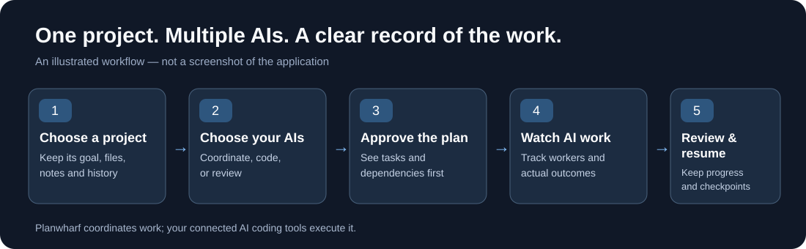

# Planwharf in 40 seconds — demo guide

**Goal:** Make Planwharf understandable without requiring viewers to know what an orchestrator, CLI, MegaTask, or checkpoint is.

**One-sentence hook:** **"Give one project to multiple AI coding agents — and keep track of what they actually do."**

The graphic below is a **conceptual illustration**, not a product screenshot:

## Real screen-recording storyboard (40 seconds)

Record the **actual Planwharf interface**, not a mock UI. Use a throwaway project with safe sample code and preconfigured, authenticated test accounts. The sequence below is an editorial shot list, **not proof that every step was captured or every provider was tested**.

| Time | Show on screen | On-screen caption |
| --- | --- | --- |
| 0–5 s | Open Planwharf's Project Home for a small, named sample project. Show its goal clearly. | **One project. One clear goal.** |
| 5–11 s | Open Orchestrator and show the selected lead and permitted Worker / Reviewer roles for available models. | **Choose which AIs coordinate, code and review.** |
| 11–17 s | Show a prepared MegaTask with bounded SubTasks. Click **Approve MegaTask**. | **You approve the work before it starts.** |
| 17–26 s | Show real worker processes and their statuses; use a safe accelerated cut instead of faking simultaneous runs. | **See the work happening.** |
| 26–33 s | Return to Home and show a completed result: changed files, reported tests and the next action. | **Know what actually changed.** |
| 33–40 s | Show an existing stopped/paused run's checkpoint and the Resume preview (or a real Pause / Stop / Resume flow when available). | **Stop, return, and continue without starting over.** |

### Final frame

**Planwharf — Your projects. Your AIs. Your control.**

[Download the latest release](https://github.com/benitz94/Planwharf/releases/latest) · [Quick start](QUICKSTART.md) · [FAQ](FAQ.md)

## Recording rules

- Capture genuine UI states and executions. If an action is unavailable or fails, fix the scenario rather than inventing a success screen.
- Use a disposable repository, no private source code, no personal information, no tokens/API keys, and no sensitive process output.
- Keep labels plain. Explain the jargon elsewhere; don't force beginners to read "MegaTask", "SubTask" or "Attempt" in a 40-second pitch.
- Never imply that Planwharf silently selects providers, runs work without approval, commits automatically, or fully sandboxes workers.
- Show exact provider/model labels only if they are actually present and available. If only one worker ran, do not visually simulate several running in parallel.
- Prefer a short muted MP4 with burned-in captions and an optional small GIF excerpt. The GIF should be optimized, legible and faithful to the app; do not substitute a conceptual animation for a real screen capture.
- Do not add the final video to the README until the recorded flow has been reviewed against the current product. Replace the explanatory SVG with the real demonstration or place the video directly beneath it.

## Where the finished clip goes

1. Near the top of the repository README, immediately after the one-sentence product explanation.
2. In GitHub Releases or another stable publicly accessible location for the playable video.
3. Optionally on a future product landing page, with the same captions and release link.

A successful demo should let someone answer three questions in under a minute: **What is it? What do I do? Why is it better than running coding agents separately?**
